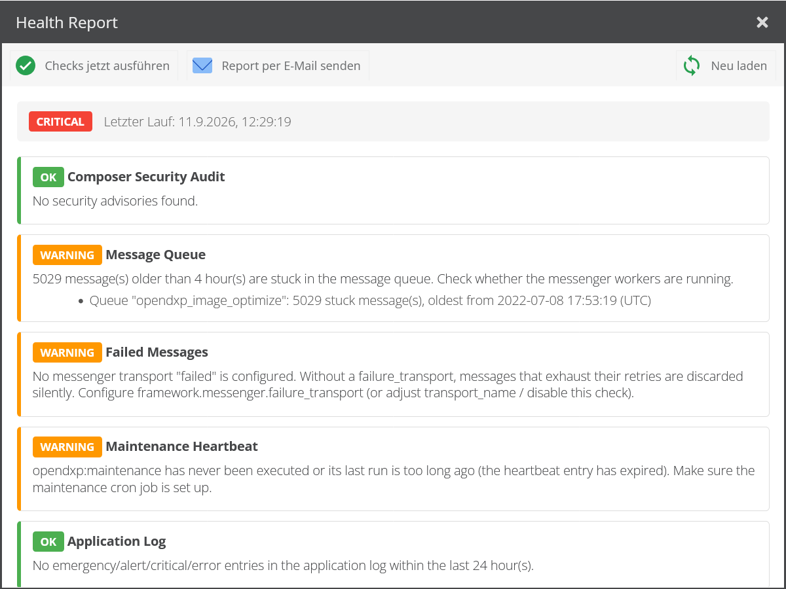
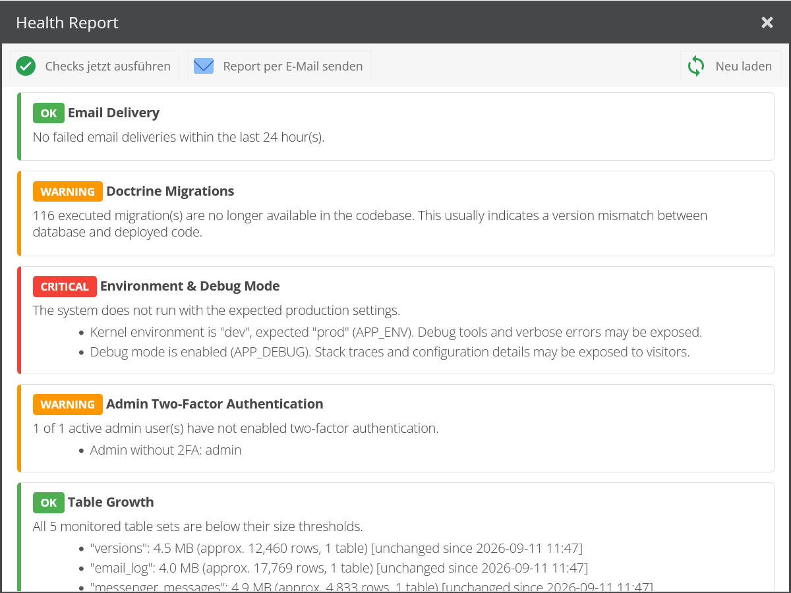
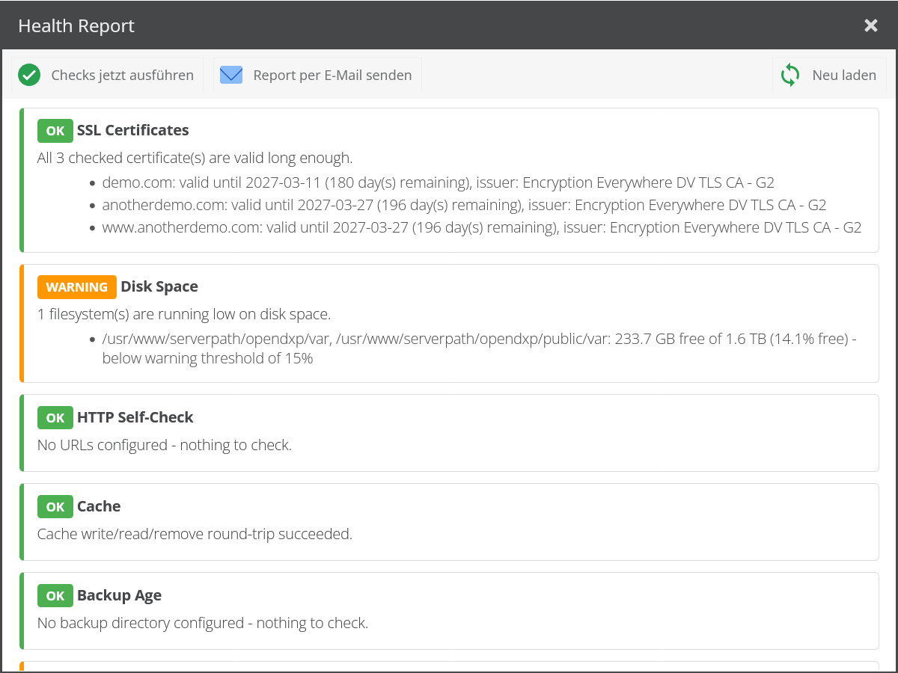
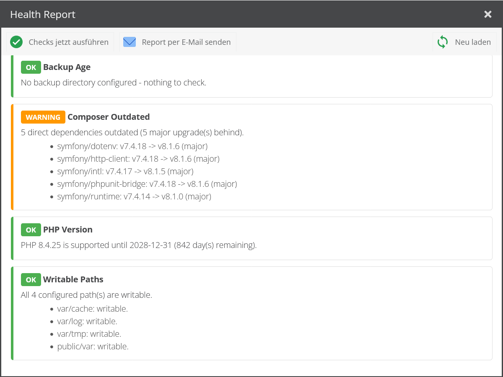
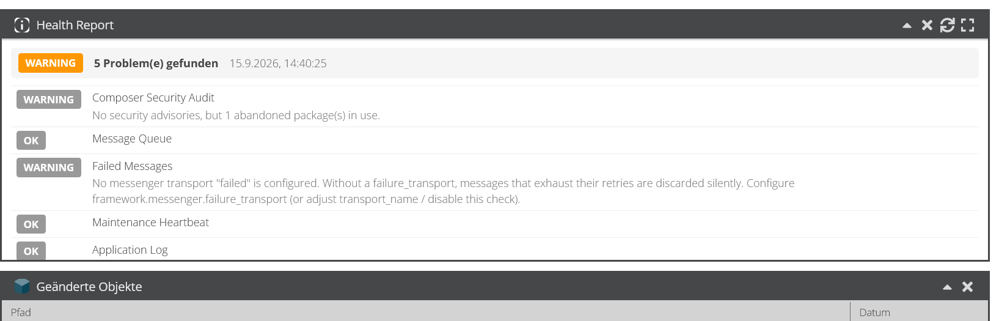

# Pringuin OpenDXP Health Bundle

Health checks for OpenDXP projects. Runs a set of checks via CLI command (cron) or from the
admin UI, stores the latest report for display in the admin and optionally sends it via email.



## Checks

| Check | Config key | Reports |
|---|---|---|
| Composer Security Audit | `composer_audit` | Security advisories from `composer audit` (critical), abandoned packages (warning) |
| Message Queue | `message_queue` | Messages stuck in the Doctrine messenger table longer than the configured age (warning) |
| Failed Messages | `failed_messages` | Messages in the messenger failure transport (critical); warns when no failure transport is configured at all |
| Maintenance Heartbeat | `maintenance` | `opendxp:maintenance` not executed within the configured interval (warning) |
| Application Log | `application_log` | Error-level entries in `application_logs` within the configured time window (warning) |
| Email Delivery | `email_log` | Failed email deliveries in the OpenDXP email log and, optionally, send volume peaks above a configured maximum per time window (warning) |
| Doctrine Migrations | `doctrine_migrations` | Pending migrations (critical), executed migrations missing from the codebase (warning) |
| Environment & Debug Mode | `environment` | Kernel environment differs from the expected one or debug mode is enabled (critical) |
| Admin Two-Factor Authentication | `admin_two_factor` | Active admin users without 2FA (warning) |
| Table Growth | `table_growth` | Housekeeping-sensitive tables (versions, logs, queue) exceeding size thresholds; shows growth since the last run (warning/critical) |
| Disk Space | `disk_space` | Free disk space on the filesystems of the configured paths below the percentage thresholds (warning/critical) |
| SSL Certificates | `ssl_certificate` | Expiring/expired TLS certificates and hostname mismatches for the configured or auto-detected domains (warning/critical) |
| HTTP Self-Check | `http_self_check` | Fetches configured URLs from the server and checks status code and response time (warning/critical); does nothing without configured URLs |
| Cache | `cache` | Write/read/remove round-trip against the OpenDXP cache to detect a broken backend (critical) |
| Backup Age | `backup_age` | Age of the newest backup file in a configured directory (warning/critical); does nothing without a configured directory |
| Composer Outdated | `composer_outdated` | Outdated direct dependencies from `composer outdated --direct`, highlighting watched packages (e.g. OpenDXP core) and major-version lag (warning) |
| PHP Version | `php_version` | Running PHP version against its end-of-life date (warning before, critical after EOL) |
| Writable Paths | `writable_paths` | Configured directories (var/ subdirs, asset storage) not writable by the current user (critical) or missing (warning) |

Additional checks can be added by implementing
`Pringuin\OpenDxpHealthBundle\Check\HealthCheckInterface` — implementations are picked up
automatically (autoconfigured service tag `pringuin_opendxp_health.check`).

## Installation

```bash
composer require pringuin/opendxp-health-bundle
```

Register the bundle in `config/bundles.php`:

```php
return [
    // ...
    Pringuin\OpenDxpHealthBundle\PringuinOpenDxpHealthBundle::class => ['all' => true],
];
```

Install the bundle (registers the `pringuin_health` admin permission):

```bash
bin/console opendxp:bundle:install PringuinOpenDxpHealthBundle
bin/console assets:install --symlink
```

Grant the `pringuin_health` permission (category "Pringuin Health Bundle") to the users/roles
that should see the report in the admin UI.

## Configuration

All keys with their defaults (`config/packages/pringuin_opendxp_health.yaml`):

```yaml
pringuin_opendxp_health:
    mail:
        enabled: true          # send the report via email when the command runs
        recipient: ~           # null = main email address from OpenDXP system settings (opendxp.email.sender.email)
        min_status: warning    # lowest overall status that triggers a mail: ok | warning | critical | error
    checks:
        composer_audit:
            enabled: true
            process_timeout: 300
        message_queue:
            enabled: true
            max_age_hours: 4   # messages older than this are considered stuck
            queue_names: []    # empty = check all queues in the messenger table
            excluded_queue_names: [failed]  # covered by the failed_messages check
            table_name: messenger_messages
        failed_messages:
            enabled: true
            transport_name: failed  # name of framework.messenger.failure_transport
            list_limit: 10          # max failed messages listed in the report details
        maintenance:
            enabled: true
            max_age_minutes: 60     # max accepted age of the last opendxp:maintenance run
        application_log:
            enabled: true
            max_age_hours: 24
            priorities: [emergency, alert, critical, error]
        email_log:
            enabled: true
            max_age_hours: 24
            max_emails_per_window: 0        # 0 = no send volume check; e.g. 20 warns on more than 20 emails per window
            window_minutes: 60              # length of the sliding window for max_emails_per_window
        doctrine_migrations:
            enabled: true
        environment:
            enabled: true
            expected_environment: prod
        admin_two_factor:
            enabled: true
        table_growth:
            enabled: true
            # keys may contain SQL LIKE wildcards (%); matching tables are aggregated per entry
            tables:
                versions:            { warning_mb: 2048, critical_mb: 8192 }
                email_log:           { warning_mb: 512,  critical_mb: 2048 }
                messenger_messages:  { warning_mb: 512,  critical_mb: 2048 }
                'application_logs%': { warning_mb: 1024, critical_mb: 4096 }
                tmp_store:           { warning_mb: 512,  critical_mb: 2048 }
        ssl_certificate:
            enabled: true
            domains: []                     # empty = main domain from system settings + all site domains
            port: 443
            connection_timeout: 10          # TLS connection timeout in seconds per domain
            warning_days: 21
            critical_days: 7
        disk_space:
            enabled: true
            # relative paths are resolved against the project directory;
            # paths on the same filesystem are measured only once
            paths: [var, public/var]
            warning_percent: 15
            critical_percent: 5
        http_self_check:
            enabled: true
            urls: []                        # empty = nothing is checked; e.g. ['https://example.com/', 'https://example.com/admin']
            expected_status_codes: [200]
            timeout: 10                     # request timeout in seconds per URL
            warning_response_time_ms: 2000
            critical_response_time_ms: 5000
            verify_tls: true                # disable for internal self-calls the certificate does not cover
            max_redirects: 20               # 0 = check the status code of the URL itself, e.g. to catch unwanted redirects
        cache:
            enabled: true
        backup_age:
            enabled: true
            directory: ~                    # null = nothing is checked
            file_pattern: '*'               # glob() pattern within the directory
            warning_hours: 26
            critical_hours: 50
        composer_outdated:
            enabled: true
            watch_packages: [open-dxp/opendxp]  # always a warning when outdated, listed separately
            process_timeout: 300
        php_version:
            enabled: true
            warning_days: 90                # warn this many days before the PHP EOL date
            eol_dates: {}                   # override/extend the built-in EOL table, e.g. { '8.5': '2029-12-31' }
        writable_paths:
            enabled: true
            paths: [var/cache, var/log, var/tmp, public/var]
    status_endpoint:
        enabled: false                      # public token-protected status endpoint, off by default
        token: ~                            # required shared secret (>= 32 chars); without it the endpoint stays hidden (404)
        expose_details: false               # include the full report (details, host name) in the response
```

The `email_log` send volume check is off by default because the normal volume differs per
project. Set `max_emails_per_window` to a value clearly above the regular peak (including
newsletter or campaign sends) — its purpose is to catch mail loops and runaway jobs, not to
police everyday traffic:

```yaml
pringuin_opendxp_health:
    checks:
        email_log:
            max_emails_per_window: 20
            window_minutes: 60
```

The check does not just count the emails since the last run: it looks for the busiest
`window_minutes` long window anywhere within `max_age_hours`, so a burst is still reported when
the check runs only once a day. `window_minutes` must therefore not exceed `max_age_hours`.

The `ssl_certificate` check connects from the server to the domains itself; if internal DNS or
firewall rules prevent that, configure reachable domains explicitly or disable the check.
Without configured `domains` it connects to every domain entered in the system settings and the
sites. Admin users who may edit sites can thereby make the server open TLS connections to
arbitrary hosts on the configured port, and the connection errors in the report reveal whether
such a host is reachable from the server. On servers with access to sensitive internal networks,
configure `domains` explicitly so the site settings are not used.

The `environment` check reports critical on every non-prod system by design. Disable it for
local development in `config/packages/dev/pringuin_opendxp_health.yaml`:

```yaml
pringuin_opendxp_health:
    checks:
        environment:
            enabled: false
```

Note on `failed_messages`: OpenDXP does not configure a messenger `failure_transport` by
default — messages that exhaust their retries are then discarded silently. Recommended project
configuration:

```yaml
framework:
    messenger:
        failure_transport: failed
        transports:
            failed: "doctrine://default?queue_name=failed"
```

Note on `composer_audit` / `composer_outdated`: composer runs as the PHP process user. The
binary is taken from `COMPOSER_BINARY` (environment or `.env.local`), then `composer` in `PATH`,
`composer.phar` in the project root and common install paths. Use Composer >= 2.8 — older
versions emit PHP 8.4 deprecation notices and have known vulnerabilities. Private repositories
need credentials, just like `composer install`: a project `auth.json`, `COMPOSER_AUTH` or the
global `auth.json` in the user's composer home (`COMPOSER_HOME`, `~/.config/composer` or
`~/.composer`). Without `HOME` (e.g. php-fpm with `clear_env`), the home directory of the process
user's passwd entry is used; if that is unavailable too, `var/pringuin-health-composer-home` in the
project. Composer runs with `--no-plugins`, so no plugin code is executed from within a web request;
repositories that are only reachable through a composer plugin are therefore not supported.
A failed composer run is retried once after a few seconds. If composer still cannot reach
packagist.org or another repository (e.g. `curl error`, `Could not resolve host`), both checks report
a warning instead of an error, so short network outages do not trigger error mails.

## Usage

### CLI / Cron

```bash
bin/console pringuin:health:check            # run checks, store report, mail per config
bin/console pringuin:health:check --mail     # always send the report via email
bin/console pringuin:health:check --no-mail  # never send an email

# only mail when the overall status is at least this severe, overriding mail.min_status
bin/console pringuin:health:check --mail-min-status=critical
```

`--mail`, `--no-mail` and `--mail-min-status` all decide the same thing and therefore cannot be
combined. `--mail-min-status` also sends when `mail.enabled` is `false`, because passing it is an
explicit request for that run.

Exit codes: `0` = healthy, `1` = issues found, `2` = a check could not be executed,
mail delivery failed or another run was still in progress (useful in combination with cron `MAILTO`).

Only one run can happen at a time: the command and the "Run now" button in the admin UI share a
lock (Symfony Lock, stored in the database by OpenDXP). A second run is refused instead of
starting the composer processes again; the admin UI answers with HTTP `409`.

Cron example (every night at 03:17):

```
17 3 * * * /usr/bin/php /path/to/project/bin/console pringuin:health:check >> /var/log/opendxp-health.log 2>&1
```

### Mail threshold

A mail is sent when the overall status of the report is at least as severe as the threshold.
The severity order is `ok` < `warning` < `critical` < `error` (`error` means a check itself could
not be executed, e.g. a missing composer binary), so `min_status: critical` also mails execution
errors.

| Threshold  | Mails on                                      |
|------------|-----------------------------------------------|
| `ok`       | every run, healthy or not                     |
| `warning`  | any issue (default)                           |
| `critical` | critical findings and check execution errors  |
| `error`    | check execution errors only                   |

Two schedules, one for urgent findings and one for the full picture:

```
# hourly, mails only on critical findings and execution errors
7 * * * * /usr/bin/php /path/to/project/bin/console pringuin:health:check --mail-min-status=critical >> /var/log/opendxp-health.log 2>&1

# Mondays at 06:17, mails on every issue including warnings
17 6 * * 1 /usr/bin/php /path/to/project/bin/console pringuin:health:check --mail-min-status=warning >> /var/log/opendxp-health.log 2>&1
```

Every run stores its report for the admin UI regardless of the threshold, and every mail contains
the complete report, not just the findings above the threshold.

### Admin UI

Menu **Tools → Health Report** (requires the `pringuin_health` permission): shows the last
stored report and offers *Run checks now* and *Send report via email*.

The window lists every check with its status badge, a summary line and the findings behind it.
Scrolled through on a deliberately unhealthy demo installation:







**Dashboard portlet:** on a dashboard (e.g. the *Welcome* tab), use *Add portlet → Health
Report* to pin a compact status overview (overall status, per-check badges, issue summaries).
The portlet's header tools refresh it and open the full report window. It is only offered to
users with the `pringuin_health` permission.



The admin UI labels follow the admin user's language; German and English ship with the bundle
(`translations/admin.de.yaml`, `translations/admin.en.yaml`), which is why the screenshots above
are German. The check summaries and details in the report itself are English.

Note: running the checks from the admin executes `composer audit` and `composer outdated`
synchronously; depending on network speed this can take a while and may hit the PHP/web server
request timeouts. Prefer the cron run for regular reports.

### Status endpoint (external monitoring)

A public, token-protected endpoint exposes the status of the last stored report for uptime
monitors (Uptime Kuma, Icinga, UptimeRobot, ...). It is disabled by default; enable it and set a
random token of at least 32 characters (e.g. `openssl rand -hex 32`):

```yaml
pringuin_opendxp_health:
    status_endpoint:
        enabled: true
        token: '%env(HEALTH_STATUS_TOKEN)%'
```

```
GET /pringuin/health/status
Authorization: Bearer <token>        # or: X-Health-Token: <token>
```

Send the token as a header where the monitor supports it. `?token=<token>` is accepted as well
for monitors that cannot set headers, but query strings end up in access and proxy logs.

- HTTP `200` when the last report is healthy, `503` when it contains issues or no report exists
  yet — so a monitor can alert on the status code alone.
- The JSON body contains the overall status, the issue count, the report date and the status of
  each check. The check summaries and details are only included with `expose_details: true`:
  they can contain admin user names, email addresses, log excerpts and vulnerable package
  versions.
- `403` on a missing/wrong token (logged as a warning); `404` when disabled or no token of at
  least 32 characters is configured (the endpoint never reveals itself unauthenticated; a too
  short token is logged as an error).
- Every response is sent with `Cache-Control: no-store`, so neither the OpenDXP full page cache
  nor a reverse proxy serves a stale "healthy" answer.

The endpoint only returns the **stored** report; it never runs the checks itself, so it cannot
be used to trigger expensive work. Run `pringuin:health:check` via cron to keep it fresh, and
put the endpoint behind a rate limit at the web-server/proxy layer.

## Development

```bash
composer install
composer test          # or: vendor/bin/phpunit
```

The suite consists of unit tests only — no database, no booted kernel. Checks that talk to the
database receive a mocked `Doctrine\DBAL\Connection`, so the SQL itself is not executed;
`EmailLogCheckTest` therefore asserts the window frame of the send volume query as a string. The
query was verified manually against MySQL 8.0 and MariaDB 11.4.

Bundle state (the last report, the previous table size measurement) goes through
`Storage\SettingsStorageInterface` instead of `OpenDxp\Model\Tool\SettingsStore` directly, so
`TableGrowthCheck` and `HealthReportStorage` can run against the in-memory double in `tests/Double`.
Add new state to that interface rather than calling the settings store from a check.

Collaborators the checks cannot reach into are injected through interfaces, so every check except
the two below is covered: `Storage\SettingsStorageInterface` for bundle state and
`Util\ComposerRunnerInterface` for the composer processes. The composer checks receive it wrapped in
`Util\ComposerJsonRunner`, which owns running the command and decoding its JSON output; the
doubles for both live in `tests/Double/ComposerRunnerDoubles`. `SslCertificateCheck` keeps only the
TLS socket itself; the evaluation of a parsed certificate (expiry thresholds, subjectAltName and
wildcard matching) lives in `Util\CertificateEvaluator` and is tested against plain arrays.

Not covered: `CacheCheck` calls the static `OpenDxp\Cache` facade and `AdminTwoFactorCheck` builds
a `User\Listing` itself, so neither can be substituted in a unit test.

- `CacheCheck` would become testable by injecting `OpenDxp\Cache\Core\CoreCacheHandler` — the
  facade is only a static wrapper around that service and offers the same `isEnabled()`, `save()`,
  `load()` and `remove()`. All five branches of the check would then be reachable.
- `AdminTwoFactorCheck` cannot be covered meaningfully without a database: its logic *is* the
  listing condition. That needs a booted kernel plus an installed OpenDXP schema, i.e. a separate
  integration suite that cannot run standalone.

## Email recipient resolution

1. `pringuin_opendxp_health.mail.recipient` if configured
2. Otherwise the main email address from the OpenDXP system settings
   (`opendxp.email.sender.email`)

The sender address is taken automatically from the OpenDXP email system settings
(`OpenDxp\Mail` default behavior).

## Security

Please do not report vulnerabilities in public issues — see [SECURITY.md](SECURITY.md).

## License

Copyright (C) PRinguin GbR (Daniel Brinkmann & Lennart Fries)

This bundle is free software: you can redistribute it and/or modify it under the terms of the
GNU General Public License as published by the Free Software Foundation, either version 3 of the
License, or (at your option) any later version — the same license as OpenDXP itself. See
[LICENSE](LICENSE) for the full text.
